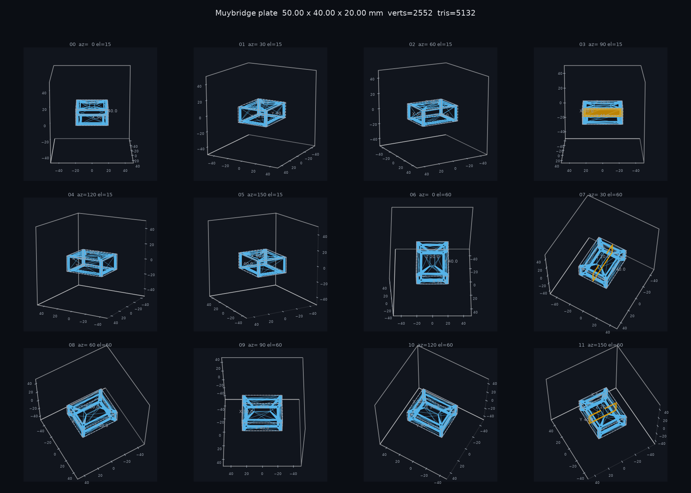

# Muybridge CAD

[](https://github.com/apandya55/muybridge-cad/actions/workflows/ci.yml)
[](LICENSE)
[](https://python.org)
[](https://nextjs.org)
[](https://build123d.readthedocs.io/)
[](https://openscad.org)

**Autonomous CAD synthesis and geometric verification with 12-angle multi-view visual inspection.**

Named after **Eadweard Muybridge**—whose 1878 high-speed multi-camera setup proved whether a galloping horse ever becomes fully airborne—Muybridge CAD captures twelve synchronized camera angles and planar cross-sections to inspect generated 3D solid models from every vantage point.



---

## Why Muybridge?

Traditional CAD code generation relies on naive geometric checks: does the mesh compile, is it manifold, and does its bounding box fit the prompt?

These checks easily miss real-world manufacturing defects:
- Internal blind holes and undrilled screw bosses
- Overly thin walls that collapse under FDM slicing
- Disconnected floating geometry that looks correct from a single orthographic perspective
- Inverted cutouts or pocket features on rear faces

Muybridge compiles the model, casts hundreds of inward normal rays to measure true minimum wall thickness, and generates a **12-angle contact sheet** (two elevation tiers, 30° azimuth intervals, plus orthogonal cross-section slices). A multimodal vision model inspects the contact sheet to catch spatial defects and iteratively patches the source code until the part passes all engineering criteria.

Works 100% offline for local CAD compilation, STL inspection, and contact sheet generation—or connect Anthropic/OpenAI to run autonomous prompt-to-part synthesis and critique loops.

---

## Architecture

```
                       ┌─────────────────────────┐
                       │   User Prompt or Code   │
                       └────────────┬────────────┘
                                    │
                                    ▼
                       ┌─────────────────────────┐
                       │  Sandboxed CAD Runner   │
                       │ (build123d / OpenSCAD)  │
                       └────────────┬────────────┘
                                    │ compiled STL
                                    ▼
          ┌──────────────────────────────────────────────────┐
          │            Computational Geometry Engine         │
          │  • Watertightness test                           │
          │  • Non-manifold edge count & volume check        │
          │  • Inward ray casting (true wall thickness mm)   │
          │  • Bounding box extent tolerance matching        │
          └─────────────────────────┬────────────────────────┘
                                    │ clean mesh
                                    ▼
          ┌──────────────────────────────────────────────────┐
          │             12-View Muybridge Renderer           │
          │  • 6 low-elevation views  (15° el, 0°-150° az)   │
          │  • 6 high-elevation views (60° el, 0°-150° az)   │
          │  • 3 orthogonal cross-sectional planar slices    │
          │  • Wireframe overlays & bounding box dimensions  │
          └─────────────────────────┬────────────────────────┘
                                    │ 1820x1300 plate.png
                                    ▼
                        ┌───────────────────────┐
                        │ Vision Critic Review  │
                        │ (Claude 3.5 / GPT-4o) │
                        └───────────┬───────────┘
                                    │
                         Pass? ─────┴───── Fail?
                           │                │
                           ▼                ▼
                     [Ready to 3D     [Auto-Patch Source
                       Print STL]      & Retry Pass]
```

---

## Features

- **Dual CAD Engine Support**: Native execution for **build123d** (Python parametric CAD) and **OpenSCAD**.
- **Accurate Wall Thickness Ray-Casting**: Inward-normal vector ray intersections calculate actual material thickness across arbitrary curved and hollow geometries.
- **Planar Section Slicing**: Cuts orthogonal cross-sections directly through the geometric centroid, rendering filled internal profiles to reveal hidden voids.
- **Interactive Three.js Studio**: Real-time 3D orbit viewport with solid/wireframe toggle, live assertion badge status, and critique history.
- **Live Server-Sent Events (SSE)**: Streams compile passes, geometry assertion results, contact sheet renders, and critique notes in real time.
- **Zero-Key Offline Mode**: Run geometric validation, mesh checking, and contact sheet generation completely locally without an API key.

---

## Quickstart

### 1. Prerequisites
- **Python 3.11+**
- **Node.js 20+**
- *(Optional)* **OpenSCAD** (`brew install openscad` on macOS or `sudo apt-get install openscad` on Ubuntu)

### 2. Backend Setup

```bash
cd backend
python3 -m venv .venv
source .venv/bin/activate
pip install -r requirements.txt
cp .env.example .env
```

To enable autonomous vision critique loops and prompt-to-CAD drafting, set your API key in `backend/.env`:

```ini
LLM_PROVIDER=anthropic
ANTHROPIC_API_KEY=your_key_here
LLM_MODEL=claude-sonnet-5-5
```

Start the FastAPI backend:

```bash
uvicorn main:app --reload --port 8000
```

Verify backend health:

```bash
curl http://localhost:8000/api/health
```

### 3. Frontend Setup

In a separate terminal:

```bash
cd frontend
npm install
npm run dev
```

Open **`http://localhost:3000`** in your browser. The Next.js studio automatically proxies API and artifact calls to `:8000`.

---

## Running Tests

Run the full pytest suite (13 unit and integration tests covering the compilers, geometric assertions, plate rendering, and API routes):

```bash
pytest tests -v
```

Lint and type-check the frontend:

```bash
cd frontend
npm run lint
npm run build
```

---

## API Reference

### `POST /api/generate`
Drafts CAD source from an English prompt and iterates until verified. Streams progress via Server-Sent Events (`text/event-stream`).

```json
{
  "prompt": "An L-shaped mounting bracket, 40x30x20mm, with two M3 screw holes",
  "code_type": "build123d",
  "requested_dims": { "x": 40.0, "y": 30.0, "z": 20.0 }
}
```

### `POST /api/validate`
Compiles user-provided source code, runs geometric checks, renders the inspection plate, and optionally critiques the geometry.

```json
{
  "code": "from build123d import *\\nwith BuildPart() as bp:\\n    Box(20, 20, 10)\\npart = bp.part",
  "code_type": "build123d",
  "requested_dims": { "x": 20.0, "y": 20.0, "z": 10.0 }
}
```

### `GET /api/stl/{job_id}`
Returns the compiled binary STL file (`model/stl`).

### `GET /api/plate/{job_id}`
Returns the 1820x1300 PNG inspection contact sheet (`image/png`).

### `GET /api/health`
Reports compiler availability, active LLM provider, and configuration status.

---

## Configuration

All options can be configured via environment variables or a `backend/.env` file:

| Variable | Default | Description |
|---|---|---|
| `LLM_PROVIDER` | `anthropic` | `anthropic` or `openai` |
| `ANTHROPIC_API_KEY` | `""` | Anthropic API key |
| `LLM_API_KEY` | `""` | Generic LLM API key |
| `LLM_MODEL` | `claude-sonnet-5-5` | Vision model identifier |
| `LLM_BASE_URL` | `""` | Custom OpenAI-compatible endpoint URL |
| `CRITIC_MAX_ITERATIONS` | `3` | Maximum compile & repair cycles per job |
| `COMPILE_TIMEOUT_S` | `30` | Subprocess execution timeout in seconds |
| `MIN_WALL_THICKNESS_MM`| `1.0` | Minimum allowed wall thickness |
| `BBOX_TOLERANCE_MM` | `0.5` | Allowed bounding-box dimension variance |
| `WALL_THICKNESS_SAMPLES`| `256` | Number of surface sample rays cast |
| `CORS_ORIGINS` | `http://localhost:3000` | Comma-separated allowed origins |
| `OPENSCAD_BIN` | auto-detected | Path to the `openscad` executable |
| `JOBS_DIR` | `$TMPDIR/muybridge-jobs` | Directory storing compiled STL and PNG files |

---

## License

MIT © [Arnav Pandya](LICENSE)
